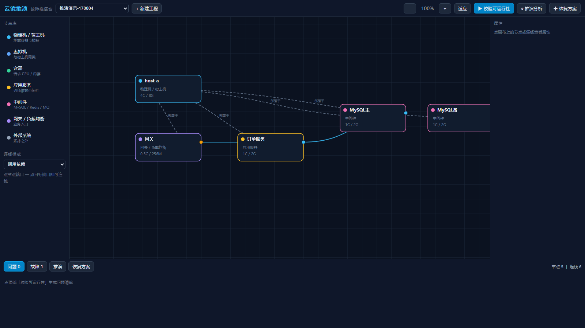

# 云镜推演（CloudMirror Deduction）

> 面向云原生系统的**故障传播分析与恢复决策平台**。
> 在无限画布上装配一套云系统（机器 / 容器 / 服务 / 端口 / 型号），先判「能不能运行」，
> 再算「故障会波及谁」，最后给「怎么救最划算」。

## 当前进度

| 阶段 | 内容 | 状态 |
| --- | --- | --- |
| P0 | 后端骨架、建表、健康检查、启动脚本 | ✅ 完成 |
| P1 | 装配数据模型 + 可运行性校验 R01–R12 + 无限画布 | ✅ 完成（画布基础交互） |
| P2 | 故障注入 + 传播分析（多源 BFS）+ 历史回看 | ✅ 完成 |
| P3 | 恢复策略评估与推荐 + 冗余组 | ✅ 完成 |
| P4 | 容量感知传播、割点、隔离切口、恢复序列、自定义规则 | ✅ 算法完成（E1–E4，自定义规则待做） |
| P5 | 历史推演页 + AI 辅助诊断 | ✅ 完成（AI 无 Key 自动降级规则版） |
| P6 | 演示脚本、Docker、答辩材料 | ⏳ 待开始 |

测试：**43 个全绿**（12 条规则引擎单测、传播 10 个、恢复 11 个、性能基准、5 个真数据库接口集成测试）。



详细设计见 [`docs/工程设计说明.md`](docs/工程设计说明.md)，计划见 [`docs/开发计划.md`](docs/开发计划.md)。

## 技术栈

| 层 | 选型 | 端口 |
| --- | --- | --- |
| 前端 | Vue 3 + Vite + Element Plus + 自绘 SVG 画布 | 5173 |
| 后端 | Spring Boot 3.3.5 + MyBatis-Plus + Java 17 | 8080 |
| 数据库 | MySQL 8（库 `cloudmirror`，root/123456） | 3306 |
| AI 服务 | Python 3.11 + FastAPI（P5 接入） | 8010 |

> 端口 8000 被本机酷狗占用，本项目不使用。

## 快速启动

### 1. 后端

**方式 A：IDEA**（推荐，方便看代码）
- 用 IDEA 打开 `backend` 目录，运行 `CloudMirrorApplication`
- 需要 MySQL80 服务已启动（管理员 PowerShell：`net start MySQL80`）

**方式 B：命令行**
```bash
cd backend
mvn -DskipTests package
java -jar target/cloudmirror.jar
```

**方式 C：没有 MySQL 时用 H2**
```bash
java -jar target/cloudmirror.jar --spring.profiles.active=h2
```
（数据文件在 `backend/data/`，删掉即清库）

启动后：
- 健康检查 <http://127.0.0.1:8080/api/health>
- 接口文档 <http://127.0.0.1:8080/swagger-ui.html>

### 2. 前端

```bash
cd frontend
npm install
npm run dev
```
访问 <http://127.0.0.1:5173>

### 2.5 AI 服务（可选）

```bash
cd ai-service
pip install -r requirements.txt
python -m uvicorn app.main:app --port 8010
```

- 不配 Key 也能跑：`/ai/diagnose` 自动降级为规则诊断（`source=fallback`）
- 配了 Key 走大模型：复制 `.env.example` 为 `.env`，填 `LLM_API_KEY`（DeepSeek / 豆包都支持 OpenAI 兼容协议）
- 后端连不上 AI 服务时，还会再降一级用本地规则（`source=local-fallback`），页面不报错

### 3. 一键脚本

`scripts/` 目录下：

| 脚本 | 作用 |
| --- | --- |
| `一键启动.bat` | 同时起后端（H2）+ 前端演示服（4173），最省事 |
| `启动后端.bat` | 连 MySQL 起后端（8080） |
| `启动后端-H2.bat` | 不装 MySQL 也能跑（数据在 backend/data） |
| `启动前端.bat` | 开发模式（5173，改代码热更新） |
| `启动前端-演示.bat` | 构建 + 演示模式（4173，更稳） |
| `启动AI服务.bat` | Python AI 服务（8010，可选） |

启动后打开 **<http://localhost:4173>**（演示）或 <http://localhost:5173>（开发）。

## Docker 一键部署

需要本机装好 Docker Desktop。在项目根目录执行：

```bash
docker compose up -d --build
```

| 服务 | 浏览器/端口 |
| --- | --- |
| 前端（nginx） | <http://localhost:8088> |
| 后端 | <http://localhost:8080/api/health> |
| AI 服务 | <http://localhost:8010/ai/health> |
| MySQL | 宿主机 `3307` → 容器 `3306`（避开本机 MySQL80） |

- 数据库结构由后端启动时自动执行 `sql/init.sql`（幂等）。
- AI Key 用环境变量传：`LLM_API_KEY=sk-xxx docker compose up -d`。
- 停止：`docker compose down`；连数据一起清：`docker compose down -v`。

> 说明：当前开发机没装 Docker，以上配置未在本机实际跑过；语法与镜像版本已按标准写法核对。

## 目录结构

## 目录结构

```
backend/    Spring Boot 后端（controller / service / mapper / entity / dto）
frontend/   Vue 3 前端（无限画布 + 面板）
docs/       设计文档与开发计划
scripts/    启动脚本
ai-service/ Python AI 服务（P5）
```

## 数据库

- 启动时自动执行 `backend/src/main/resources/sql/init.sql`，**幂等**，重复启动不会清数据。
- JDBC 串带 `createDatabaseIfNotExist=true`，库不存在会自动建。

## 约定

- 统一返回 `{ "code": 0, "message": "ok", "data": ... }`，错误码见 `common/ErrorCode.java`
- 每个请求有 `traceId`（响应头 `X-Trace-Id`），日志里可搜
- Java 17 语言级别，不用 Lombok
- 不提交 `target/`、`node_modules/`、`data/`、`logs/`
