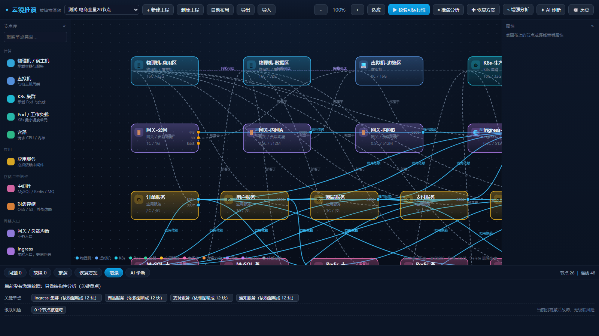

# 云镜推演（CloudMirror Deduction）

> 面向云原生系统的**故障传播分析与恢复决策平台**。
> 在无限画布上装配一套云系统（机器 / 容器 / 服务 / 端口 / 型号），先判「能不能运行」，
> 再算「故障会波及谁、多久到」，最后给「怎么救最划算、救完会不会更糟」。

**当前版本：v0.9.1**（2026-11）｜校赛版　·　后端 68 个测试全绿　·　UI 端到端 23 步全过



---

## 一、这是什么

云原生系统服务多、依赖深，一次故障会沿调用链扩散。现有工具各管一段：Kubernetes 负责编排自愈，Prometheus 负责监控告警，Chaos Mesh 负责故障注入，链路追踪负责事后定位——但没人回答「这套系统**现在能不能跑**」「故障会**传到哪、多严重**」「**先救谁**最划算」。

云镜推演把这三件事串成一条可复现的证据链：

1. **装配预检**：12 条规则（R01–R12）检查端口冲突、资源超配、依赖缺失、网络不可达、入口不可达、环路、主备不完整……
2. **故障推演**：多源反向 BFS + 容量感知 + 依赖冗余度 + 时间窗，输出受影响节点、传播路径、「必崩/可能」分级与到达时刻。
3. **恢复决策**：重启 / 切备 / 隔离三策略五维评分，多动作恢复序列，级联失效分析（备用接管过载会不会被拖垮）。
4. **复盘**：校验、推演、恢复全部落库，支持历史回看、拓扑 JSON 导入导出，同一输入永远同一结论。

> 边界：本作品是**演练沙盘**，不接入生产监控、不执行真实故障注入；恢复时间/成本/风险为模型估算值。

---

## 二、怎么跑起来

### 给普通用户（不装开发环境）

在 [Releases](https://github.com/swhchen/cloudmirror/releases) 下载 `云镜推演-校赛版-可运行.zip`，解压后按包里的 `启动说明.txt`：

1. 装 JDK 17+
2. `cd backend && java -jar cloudmirror.jar --spring.profiles.active=h2`
3. 用任意静态服务器指向 `frontend/dist`（`npx serve` 或 `python -m http.server 4173`）
4. 浏览器打开 `http://127.0.0.1:4173`

### 给开发者（从源码）

**环境**：JDK 17+、Node 18+、Maven（或 IDEA 自带）

```bash
# 1. 后端（H2，免装 MySQL）
cd backend
mvn -DskipTests package
java -jar target/cloudmirror.jar --spring.profiles.active=h2

# 2. 前端
cd ../frontend
npm install
npm run dev        # http://127.0.0.1:5173
```

- 健康检查 <http://127.0.0.1:8080/api/health>
- 接口文档 <http://127.0.0.1:8080/swagger-ui.html>
- 想用 MySQL 8：建库 `cloudmirror`（或让 JDBC 自动建），去掉 `--spring.profiles.active=h2`，改 `DB_USER/DB_PASSWORD`
- 数据文件在 `backend/data/`，删掉即清库

### AI 服务（可选）

```bash
cd ai-service
pip install -r requirements.txt
python -m uvicorn app.main:app --port 8010
```

不启动也能用：后端会自动降级到本地规则（页面会标注来源）。

### 一键脚本

| 脚本 | 作用 |
| --- | --- |
| `scripts/一键启动.bat` | 后端（H2）+ 前端演示服（4173） |
| `scripts/启动后端-H2.bat` | 不装 MySQL 也能跑 |
| `scripts/启动前端-演示.bat` | 构建 + 演示模式（4173） |
| `scripts/启动AI服务.bat` | Python AI 服务（8010，可选） |

---

## 三、五分钟看效果

1. 打开页面，右上角切到工程 **「测试-电商全量26节点」**（26 节点 / 48 连线 / 2 冗余组）
2. 点 **「校验可运行性」** → 可运行 · 100 分
3. 右键 **MySQL-主** → 注入故障 `node_down / critical`
4. 点 **「推演分析」** → 看直接/间接影响、传播路径、`+0.5s` 到达时间
5. 点 **「恢复方案」** → 三策略对比；注意级联提示：`MySQL-备 接管后 4.8/4.0，超 20% 被拖垮`
6. 点 **「增强分析」** → 关键单点（割点）、隔离切口、多动作序列、级联风险
7. 点 **「AI 诊断」** → 大模型或降级规则版说明

想从零搭这套拓扑：运行 `scripts/seed_full_scenario.ps1`（通过接口一键创建 26 节点工程）。

---

## 四、技术栈

| 层 | 选型 | 端口 |
| --- | --- | --- |
| 前端 | Vue 3 + Vite，**自绘 SVG 无限画布**（不依赖 Vue Flow / AntV G6） | 5173 / 4173 |
| 后端 | Spring Boot 3.3.5 + MyBatis-Plus + Java 17（不用 Lombok） | 8080 |
| 数据库 | MySQL 8（本地可切 H2） | 3306 / 内置 |
| AI 服务 | Python 3.11 + FastAPI，OpenAI 兼容接口，三层降级 | 8010 |
| 部署 | Docker Compose（mysql / ai / backend / frontend） | 见下 |

---

## 五、工程与测试

| 项 | 数量 |
| --- | --- |
| 数据表 | 17 张（装配 / 故障 / 校验快照 / 推演快照 / 恢复快照 / 冗余组） |
| 接口 | 13 个控制器、32 个接口 |
| 节点类型 | 11 类（宿主机 / 虚拟机 / K8s / Pod / 容器 / 服务 / 中间件 / 对象存储 / 网关 / Ingress / 外部系统） |
| 校验规则 | 12 条（R01–R12） |
| 后端测试 | **68 个**（规则、传播、恢复、级联、数据一致性、接口集成、性能） |
| UI 端到端 | **23 步**（CDP 真实点击：主链路 14 步 + 进阶交互 9 步） |
| 性能 | 500 节点 / 1000 边全量校验约 1.6 ms |

---

## 六、文档

| 文档 | 说明 |
| --- | --- |
| [`docs/工程设计说明.md`](docs/工程设计说明.md) | 架构、数据模型、算法、接口 |
| [`docs/开发计划.md`](docs/开发计划.md) | 阶段计划与完成情况 |
| [`docs/演示脚本.md`](docs/演示脚本.md) | 现场演示步骤 |
| `云镜推演-算法与功能详解.docx` | 算法公式、12 条规则逐条、级联模型（参赛材料） |
| `云镜推演-答辩与PPT演示说明.docx` | 8 分钟讲稿、逐页脚本、25 问答（参赛材料） |

---

## 七、Docker 部署

```bash
docker compose up -d --build
```

| 服务 | 地址 |
| --- | --- |
| 前端（nginx） | <http://localhost:8088> |
| 后端 | <http://localhost:8080/api/health> |
| AI 服务 | <http://localhost:8010/ai/health> |
| MySQL | 宿主机 `3307` → 容器 `3306` |

> 开发机未装 Docker，以上配置**未实测**；语法与镜像版本已核对。

---

## 八、已知限制

- 未接入真实监控（Prometheus）与真实故障注入，时间/成本/风险为估算；
- 未建模重试风暴、网络分区等复杂故障；
- 恢复方案是加权单分，尚未做 Pareto 前沿；
- Docker 未实测；未做登录与权限（字段已预留）。

## 九、目录结构

```
backend/    Spring Boot 后端（controller / service / mapper / entity / dto / sql）
frontend/   Vue 3 前端（自绘 SVG 画布 + 面板）
ai-service/ Python FastAPI AI 服务
docs/       设计文档、演示脚本、截图
scripts/    启动脚本、测试工程生成脚本
tools/      UI 端到端测试（CDP，零依赖）
```

## 十、约定

- 统一返回 `{ "code": 0, "message": "ok", "data": ... }`，错误码见 `common/ErrorCode.java`
- 每个请求带 `traceId`（响应头 `X-Trace-Id`），日志可搜
- Java 17 语言级别，不用 Lombok
- 不提交 `target/`、`node_modules/`、`data/`、`logs/`
